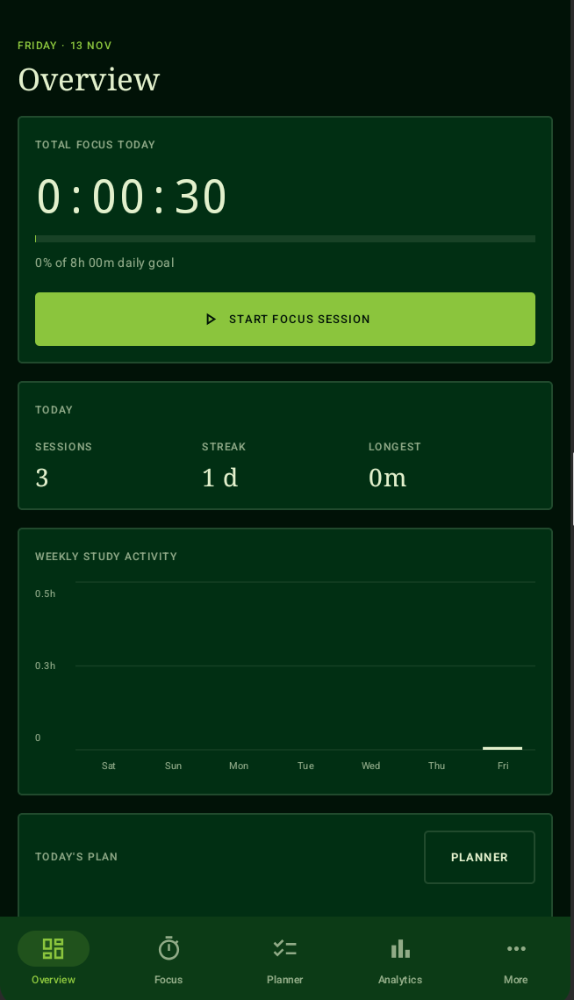
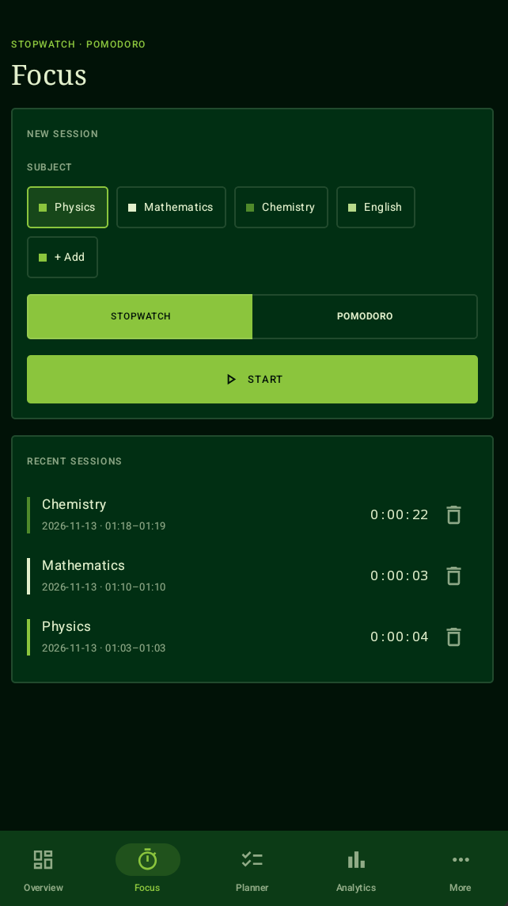
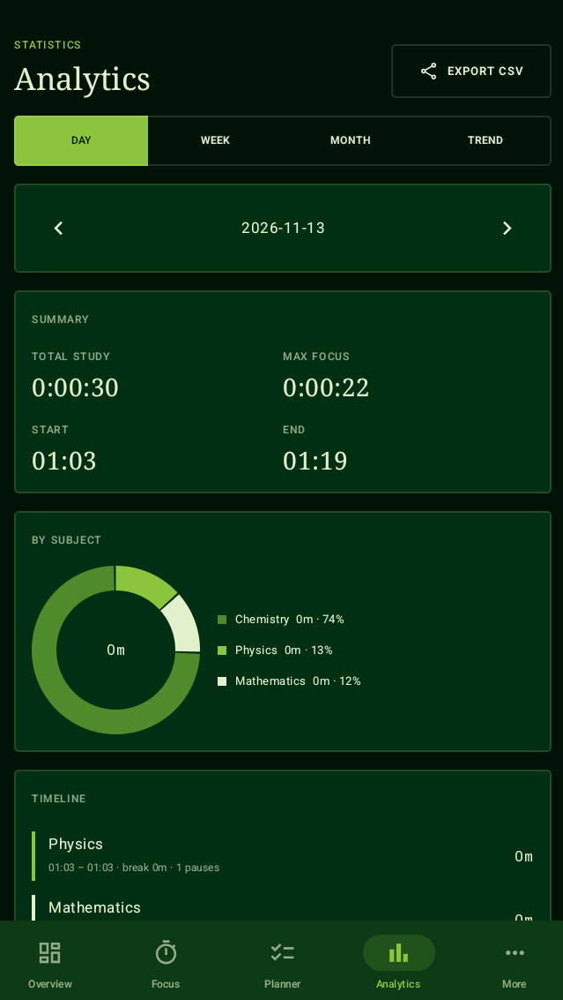
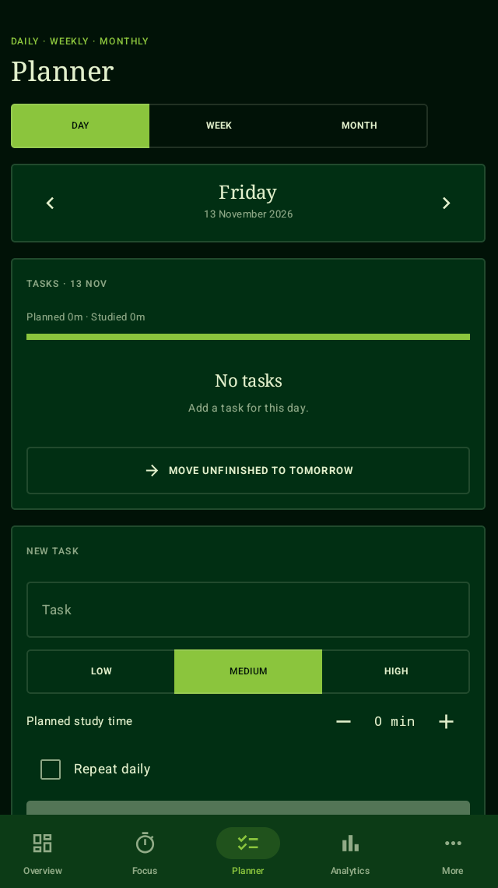
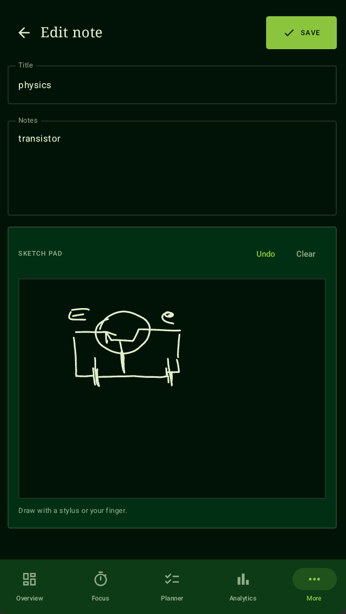
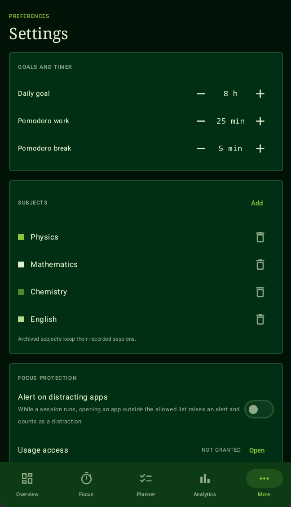

<div align="center">


# FIELDNOTE

**Study · Track · Connect · Improve**

A premium, offline-first study command center for Android phones and tablets.
Built with Kotlin and Jetpack Compose. A free, open-source alternative to YPT-style study timers.

<br>

[](https://github.com/nandandas2407-web/fieldnote/actions/workflows/build-apk.yml)


<br>

[**Download APK**](../../releases/latest) &nbsp;·&nbsp; [Features](#features) &nbsp;·&nbsp; [Design](#design-language) &nbsp;·&nbsp; [Build](#build-from-source) &nbsp;·&nbsp; [Roadmap](#roadmap)

</div>

---

## Why Fieldnote

Most study timers are either cluttered, locked behind accounts, or reskinned stopwatches. Fieldnote is built to feel like a serious workstation for studying:

- **Your data stays on your device.** No sign-up, no tracking, no network needed.
- **Everything is computed from real sessions.** Every chart, streak and total comes from the sessions you record. Nothing is hardcoded.
- **One design, two layouts.** A persistent sidebar dashboard on tablets, a compact bottom-navigation layout on phones.
- **A timer that does not die.** It runs in a foreground service and recovers after the app is killed.

---

## Screenshots

> Mobile screenshots ⬇️

| Overview | Focus | Analytics |
|:---:|:---:|:---:|
|  |  |  |

| Planner | Library | Settings |
|:---:|:---:|:---:|
|  |  |  |

---

## Features

### Focus timer
- **Stopwatch** and **Pomodoro** modes with adjustable work and break lengths
- Subject-based tracking with colour-coded subjects
- Pause, resume, finish, discard, and **switch subject** mid-session
- **Break tracking** and pause counting for every session
- Optional **session notes** saved with each session
- Ongoing notification with a live chronometer and Pause/Resume/Finish actions
- **Crash and restart recovery.** Elapsed time is rebuilt from stored timestamps
- Mini timer bar visible on every screen while a session runs

### Planner
- **Day, week and month** views
- Tasks with **priority**, **planned study minutes**, and **daily repeat**
- Planned vs. studied time shown per day, so the planner and timer are connected
- **Move unfinished tasks to tomorrow** in one tap
- **D-Day countdowns** for exams, with a date picker

### Analytics
Every view is calculated from your recorded sessions.

| View | What you get |
|---|---|
| **Day** | Total study time, max focus, start and end time, subject donut chart, session timeline |
| **Week** | Stacked bars by subject, comparison with the previous week |
| **Month** | Calendar heatmap, active days, average per active day, best day |
| **Trend** | 12-week totals, 30-day start/end regularity chart, streak, consistency |

Plus **CSV export** of all sessions.

### Rankings
- Your subjects ranked by focus time for today, 7 days, 30 days or all time
- Personal records: best day, best week, longest session, current streak

### Library
- Notes with a title and body
- A **sketch pad** for stylus or finger handwriting, with undo and clear
- Strokes are stored resolution-independently, so sketches look right on any screen

### Focus protection
- Choose an **allowed apps** list from your installed apps
- While a session is running, opening any other app raises an alert and counts as a distraction
- **Emergency exit** with a configurable hold duration
- A **floating pop-up** over the blocked app with a **Back to session** button (needs *Display over other apps*)
- A permissions checklist: Usage access, Display over other apps, Notifications and battery

### Backup and restore (JSON)
- **Settings → Backup and restore → Export** saves your whole history to one `.json` file: sessions, subjects, tasks, exams, notes and preferences
- **Import** reads that file back. Choose **Merge** (adds what is missing, keeps current data, skips duplicates) or **Replace** (erases the device data and restores the file exactly, including preferences)
- Files are plain readable JSON, so you can also inspect them or process them with your own scripts. Format below.

### Themes and customisation
- Six themes (Forest is the default), accent colours, a blurred background photo, glass strength and corner roundness
- Five timer styles: Digital, Classic, Ring, Analog, Liquid orb
- Slim or expanded tablet sidebar, and per-tab visibility

### Adaptive layout
- **Tablet and wide screens:** persistent left sidebar with the full workspace and multi-column dashboards
- **Phones:** bottom navigation with a More section
- Back-navigation returns to Overview

---

## Design language

Fieldnote uses four brand colours and derives everything else from them with opacity and blending. No random accents.

| Swatch | Name | Hex | Used for |
|:---:|---|---|---|
|  | Near-Black Green | `#011207` | Main background |
|  | Dark Forest Green | `#012F13` | Sidebar, panels, cards |
|  | Apple Green | `#8BC53D` | Actions, progress, active states, charts |
|  | Soft Sage Mint | `#E2F0CC` | Text and selected surfaces |

**Principles**
- Liquid-glass panels: gradient body, light highlight and a hairline edge, with almost no outlines
- Rounded corners you can tune in Themes
- Serif headings paired with monospaced numerals for an editorial look
- Subtle animation only: progress bars and charts grow in once
- Charts with axes, labels and legends
- Empty states that explain what to do next

---

## Get the APK

### Build it with GitHub Actions (no Android Studio needed)

1. Put this project in your own GitHub repository (fork it, or create a repo and upload the files).
2. Open the **Actions** tab. If GitHub asks, click **I understand my workflows, enable them**.
3. Choose **Build APK** in the left list, click **Run workflow**, then **Run workflow** again.
   It also runs by itself on every push to `main` or `master`.
4. Wait about 5 to 8 minutes. Open the finished run and download **Fieldnote-apk** from the *Artifacts* section at the bottom.
5. Unzip it. You get two files:
   - `Fieldnote-<version>.apk`: the release build (use this one)
   - `Fieldnote-<version>-debug.apk`: the debug build
6. Copy the APK to your phone or tablet, allow **Install unknown apps** for your file manager, and tap the file.

**Publish a Release with the APK attached:** push a tag.

```bash
git tag v1.0.0
git push origin v1.0.0
```

The workflow builds the app and creates a Release named `v1.0.0` with the APKs, ready to share from the **Releases** page. The app's version name comes from the tag.

**Optional: sign with your own key.** Without a key the release APK is signed with the debug key, which installs fine but changes if you ever switch keys. To sign with your own, add these under *Settings → Secrets and variables → Actions*:

| Secret | Value |
|---|---|
| `KEYSTORE_BASE64` | your `.jks` file as base64, e.g. `base64 -w0 release.jks` |
| `KEYSTORE_PASSWORD` | keystore password |
| `KEY_ALIAS` | key alias |
| `KEY_PASSWORD` | key password |

### Build locally

Requires JDK 17 and [Gradle 8.7](https://gradle.org/releases/) (or open the folder in Android Studio).

```bash
gradle assembleDebug      # app/build/outputs/apk/debug/
gradle assembleRelease    # app/build/outputs/apk/release/
```

**Requirements on the device:** Android 8.0 (API 26) or newer.

### Optional fonts
Run `docs/install-fonts.sh` before building to bundle the premium fonts. Without them the app falls back to system fonts and still builds.

### First launch
Allow notifications so the timer notification can show.

### Enabling focus protection
1. Open **Settings → Focus protection**.
2. Tap **Open** next to *Usage access* and grant it to Fieldnote.
3. Tap **Allowed apps** and pick the apps you still want during a session.
4. Turn on **Alert on distracting apps**.

---


## Architecture

```
app/src/main/java/app/fieldnote/
├── FieldnoteApp.kt        Application: database, settings, timer engine, shared state flows
├── MainActivity.kt        Adaptive navigation (sidebar / bottom bar)
├── core/
│   ├── TimerEngine.kt     Timestamp-based timer state, persisted to survive restarts
│   ├── TimerService.kt    Foreground service, notification, distraction monitor
│   ├── Overlay.kt         Floating "back to session" pop-up
│   ├── Backup.kt          JSON export and import
│   ├── Usage.kt           Usage Access helpers
│   └── Stats.kt           Pure functions: totals, streaks, CSV
├── data/
│   ├── Models.kt          Room entities, DAOs, database
│   └── Settings.kt        Preferences store
└── ui/
    ├── Theme.kt           Palette and Material 3 theme
    ├── Components.kt      Panel, buttons, segmented control, steppers
    ├── TimerFace.kt       Digital, Classic, Ring, Analog and Liquid orb timers
    ├── Customize.kt       Themes and customisation screen
    ├── Charts.kt          Bar, stacked, donut, regularity and heatmap charts
    └── Overview · Focus · Planner · Analytics · Social · Library · SettingsScreen
```

**Stack:** Kotlin · Jetpack Compose · Material 3 · Room · Kotlin Coroutines and Flow · Android foreground services · Gradle with KSP

**Key decisions**
- Timer state stores wall-clock timestamps, not a running counter, so elapsed time is always recomputed correctly.
- Statistics are derived from the session table. Charts never use fake data.
- Server-dependent features sit behind a clear boundary and are never simulated.

---

## Honest limitations

- **Study groups and global rankings** need a server and are not in this build. The Groups screen only checks whether a server URL is reachable. The planned API is in [`docs/BACKEND.md`](docs/BACKEND.md).
- **Focus protection detects and alerts. It does not force-close other apps.** Android only allows that through accessibility or device-admin permissions, which Fieldnote does not request.
- No Wear OS app or cloud sync yet. Backups are manual JSON files.
- Database schema is version 1 with no migrations yet.

---

## Roadmap

- [ ] Study groups, live member status and group rankings (server required)
- [ ] Accounts and cross-device sync
- [ ] Home-screen widgets
- [x] Backup and restore to a JSON file
- [ ] Release signing and Play Store build
- [ ] Wear OS companion
- [x] Extra themes and accent options
- [ ] Light theme

---

## Contributing

Ideas, bug reports and pull requests are welcome.

1. Fork the repo and create a branch.
2. Make your change and make sure the **Build APK** workflow passes.
3. Open a pull request describing what changed and why.

---

## License

Released under the [APACHE 2.0](LICENSE).

<div align="center">
<sub>Made for people who study seriously.</sub>
</div>

---

## Customisation and focus pop-up

- **Themes** (sidebar / More): six built-in themes (Forest is the default), accent colour, a blurred background photo of your choice, glass strength, corner roundness, five timer styles (Digital, Classic, Ring, Analog, Liquid orb), an optional expanded tablet sidebar and per-tab visibility.
- **Floating pop-up**: during a session, opening an app that is not on the allowed list shows a small glass card over it with a **Back to session** button. It needs the *Display over other apps* permission; Settings has a permissions checklist for every required permission.
- **Tablet layout**: slim icon rail, centred content column and a main/side two-column grid.

---

## Backup file format

```json
{
  "format": "fieldnote-backup",
  "version": 1,
  "exportedAt": 1789000000000,
  "subjects": [ { "id": 1, "name": "Physics", "color": -7616195, "archived": false } ],
  "sessions": [
    { "id": 1, "subjectId": 1, "startedAt": 1788990000000, "endedAt": 1788993600000,
      "focusMs": 3300000, "breakMs": 300000, "pauses": 1, "distractions": 0,
      "status": "completed", "note": "" }
  ],
  "todos":  [ { "title": "Revise optics", "dueDate": 20406, "priority": 1, "done": false,
                "repeatDaily": false, "plannedMin": 60, "createdAt": 1788900000000 } ],
  "exams":  [ { "name": "Physics paper 1", "date": 20450 } ],
  "notes":  [ { "title": "Lens formula", "body": "...", "strokes": "", "updatedAt": 1788950000000 } ],
  "settings": { "userName": "Student", "dailyGoalMin": 480, "themeId": "forest", "...": "..." }
}
```

Times are epoch milliseconds. `dueDate` and exam `date` are epoch days. Sessions point to a subject by `subjectId`; ids are only used to link entries inside the file and are re-created on import. Merge matches subjects by name and skips sessions, tasks, exams and notes that already exist.
